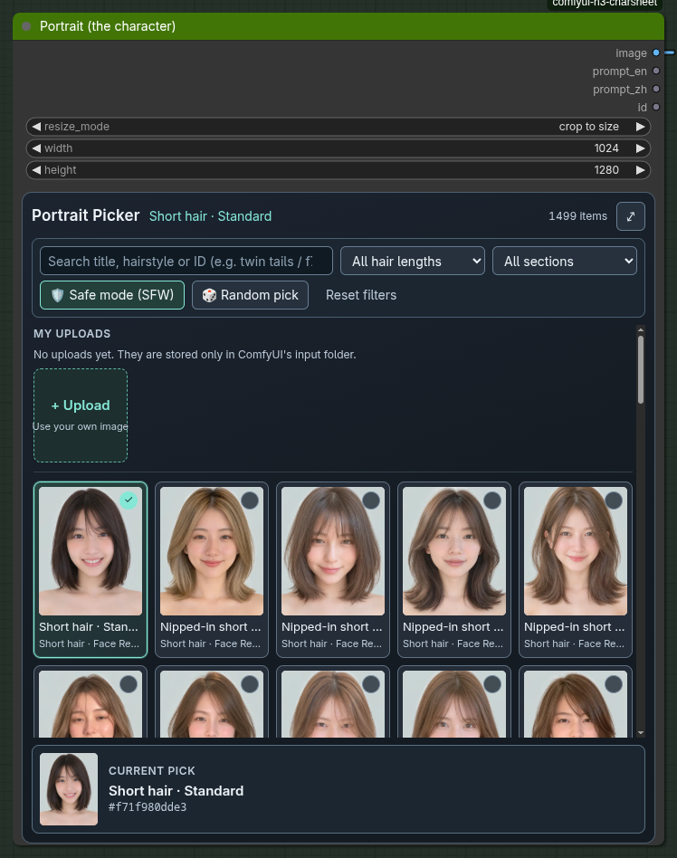
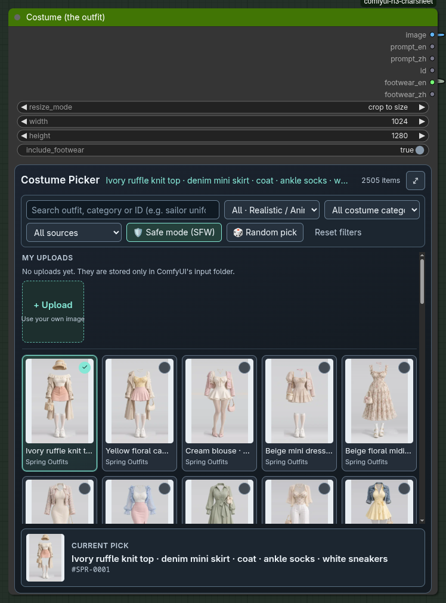
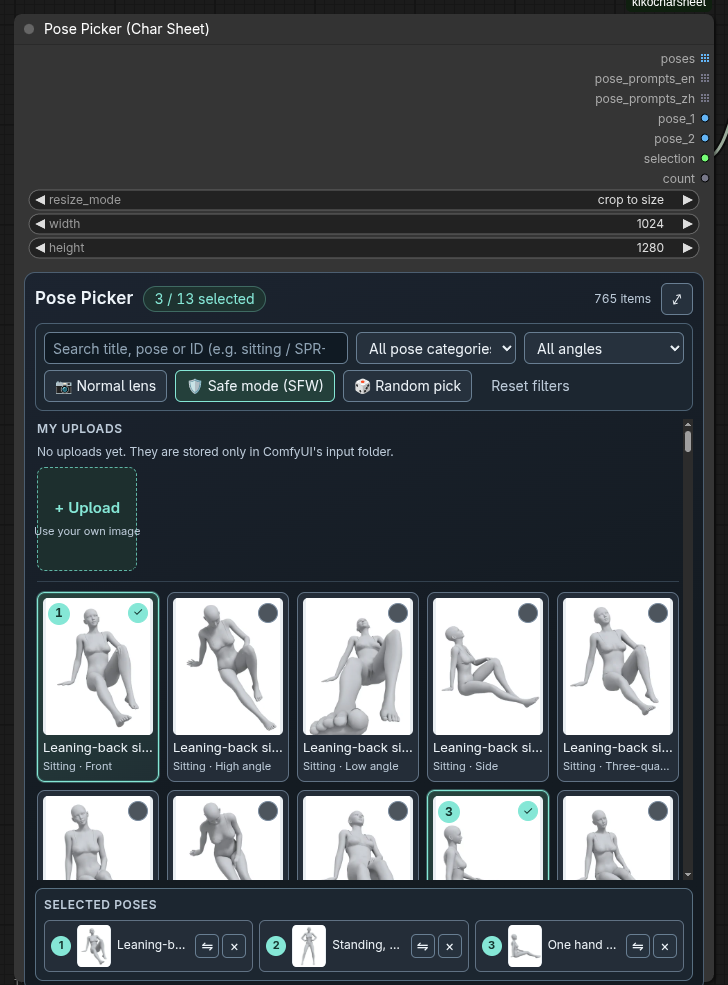
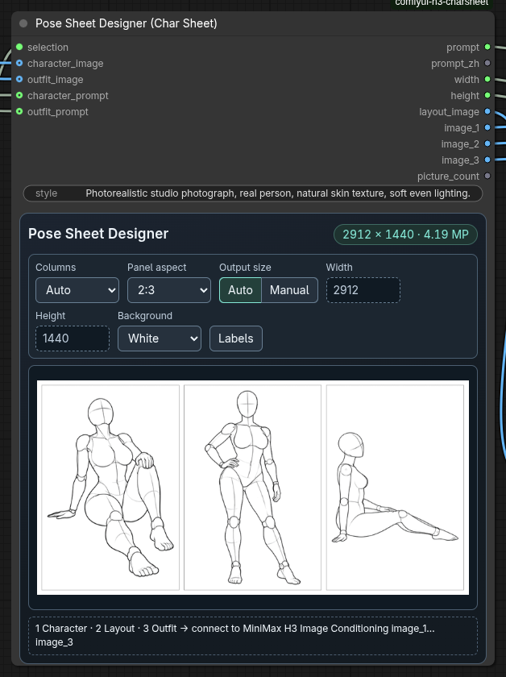
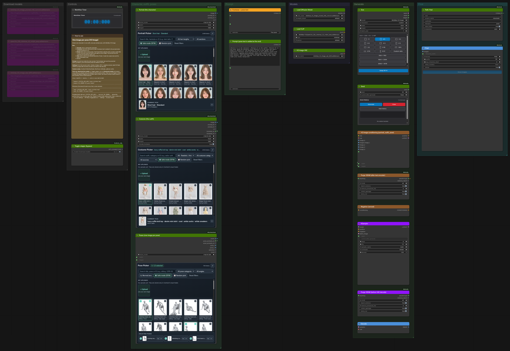

# ComfyUI-KikoCharSheet

Four ComfyUI nodes that pick references for a character sheet and prepare them for MiniMax H3 Image. They work with the H3 Character Sheet Designer pack, but do not need it.

**Help wanted.** This pack is replacing borrowed reference pictures with its own, and it needs Blender artists, costume makers and contributors. See [Help wanted](#help-wanted).

| Node | What it does | Needs the download script |
|---|---|---|
| Portrait Picker (Char Sheet) | Pick a portrait from the gallery, or one of your own uploads. Outputs the image and a prompt. | Yes: portraits and their names |
| Costume Picker (Char Sheet) | Pick a costume and a view (front, diag, side, back). Outputs the image and a prompt. | Yes: costumes and their names. The anime costumes also need internet each time |
| Pose Picker (Char Sheet) | Pick up to 13 poses, in order. Flip any of them, and switch between normal and wide-lens pose pictures. | Yes, for the pose names and categories only. The pose pictures ship with the pack |
| Pose Sheet Designer (Char Sheet) | Lays the poses out on one layout image and writes the prompt for it. | Yes, as it reads the same pose list |

The download script is one command, `python3 scripts/setup_assets.py --download`; see [Install](#install).

All four are in the `CharSheet` category. Each picker shows a browsable panel inside the node, with search, filters, safe mode, your own uploads and a full-screen view. The panel follows the ComfyUI language (English or Chinese).

| Portrait Picker | Costume Picker |
|---|---|
|  |  |

| Pose Picker | Pose Sheet Designer |
|---|---|
|  |  |

*The screenshots on this page show gallery thumbnails for illustration only. Those images belong to their creators and are not part of this pack; see [Thanks and credits](#thanks-and-credits).*

## What this pack changes and adds

The galleries and the idea of picking a portrait, a costume and a pose come from the projects credited below. This pack is a new set of nodes built around them. What is different here:

- **English throughout.** Every pose name, costume name, category, tag and hairstyle has an English translation (2,341 names, in `locales/en/data.json`). The pickers show them when ComfyUI is set to English, and the prompt outputs come in English and Chinese. The gallery project itself is in Chinese.
- **Your own images.** Each picker has an upload tile. Your pictures are stored in ComfyUI's own `input/charsheet/` folder, never inside this pack, and appear in the picker next to the gallery items. Portrait uploads get a 4:5 crop frame you can drag.
- **Pickers inside the node.** The gallery opens as a panel in the node itself, with search, filters, safe mode and a full-screen view. This follows the in-node panel of the H3 Character Sheet Designer; the gallery project's own ComfyUI nodes use a pop-up window.
- **Several poses at once.** The Pose Picker takes up to 13 poses in an order you choose, with a flip switch per pose and a normal or wide-lens version of the pose pictures.
- **Its own pose pictures.** Poses are shown as plain grey 3D model renders made for this pack, not the gallery's mannequin drawings. The build of the pose figure carries over into the generated person, and these renders have a slim build. They ship with the pack, in `poses/`.
- **A pose sheet for MiniMax H3.** The Pose Sheet Designer lays the chosen poses out on one image and writes the prompt for it, so one generation gives the same character in every pose. It is modelled on the H3 Character Sheet Designer, which does this for fixed views (front, side, back) but not for free poses.
- **Prompt controls.** A style sentence you can edit, a switch for including the footwear, and wording that tells the model to copy the outfit from the picture.

### Nodes this pack is modelled on

- **The gallery project's ComfyUI nodes** ([anhao/ai-pose-gallery-zh](https://github.com/anhao/ai-pose-gallery-zh)): its Pose, Costume and Portrait pickers are the starting point for the three pickers here.
- **H3 Character Sheet Designer** ([ukr8b3g-cmyk](https://github.com/ukr8b3g-cmyk/H3-Character-Sheet-Designer)): the in-node panel, keeping the panel's state in one hidden field, and the idea of a designer node that outputs a layout image, a prompt and a size for MiniMax H3.

Some logic is adapted from the gallery project's nodes, which are MIT licensed: how a costume's views are chosen, which categories safe mode hides, and the Chinese prompt wording. The H3 Character Sheet Designer's approach was followed, not its code. No images from either are included.

## Three ways to use poses

1. **Pose sheet.** Pose Picker, then Pose Sheet Designer, then H3 Image Conditioning. The designer outputs `prompt`, `width`, `height` and `image_1` to `image_3` (character, layout, outfit). Workflow: `example_workflows/charsheet-minimax-h3-pose-sheet.json`.
2. **H3 references.** Send the portrait to the H3 Character Sheet Designer as `character_image`, the costume as `reference_image_1`, and `pose_1` and `pose_2` as `reference_image_2` and `_3`. Workflow: `example_workflows/charsheet-h3-references.json`.
3. **One image per pose.** The Pose Picker outputs lists (`poses`, `pose_prompts_en`). ComfyUI runs what follows once per pose. Workflow: `example_workflows/charsheet-one-per-pose.json`.

### The full one-per-pose workflow

`example_workflows/kiko-charsheet-one-per-pose-v1.json` is the complete version of the third way: pick a portrait, a costume and any number of poses, queue once, and get one image per pose.



It adds a size picker, a seed history, a note with instructions, a model download group (off by default; turn it on for the first run) and two VRAM purge steps that unload the text encoder before the image model loads and the image model before decoding. It needs these packs as well as this one: [ComfyUI-KikoTools](https://github.com/ComfyAssets/ComfyUI-KikoTools), [KJNodes](https://github.com/kijai/ComfyUI-KJNodes) and [rgthree-comfy](https://github.com/rgthree/rgthree-comfy). The three `charsheet-*` workflows are the plain versions and need only this pack and ComfyUI's MiniMax H3 nodes.

All four appear in ComfyUI under Templates once the pack is installed.

The example workflows use the author's local model, text encoder and VAE file names (taken from the H3 Character Sheet example workflow). Change them to the names of your own files. They need the nodes of this pack and ComfyUI's MiniMax H3 nodes. The H3 references workflow also needs the H3 Character Sheet Designer pack.

## Blank image slots and prompt text

The designer always outputs three images, filled in the order character, layout, outfit. A picture you do not connect is left out and the later ones move up. Unused `image_n` outputs are blank 64x64 white images. The `picture_count` output says how many are real. Connect only the first `picture_count` images to the conditioning node. For example, disconnect `image_3` when no costume is used.

`character_prompt` does not need a character image. It adds a sentence that describes the person, and it works with or without a portrait. `outfit_prompt` only has an effect when an outfit image is connected. Without an outfit image, the outfit sentences are left out, including the text of `outfit_prompt`. The prompt tells the model to copy garments, colours and materials from the outfit picture; the `outfit_prompt` text only lists the garments.

The Costume Picker has an `include_footwear` switch, on by default. It adds an instruction to the costume's prompt text: wear the shoes shown in the outfit picture, or, when off, leave the shoes out. It takes effect where that text is used: connect the picker's `prompt_en` to the Pose Sheet Designer's `outfit_prompt`. The `footwear_en` and `footwear_zh` outputs hold the footwear instruction alone, for prompts you write yourself; the one-per-pose workflow uses `footwear_en`.

`style` is one sentence added near the end of the prompt. The default asks for a photorealistic studio photograph. Replace it for another look (for example an illustration style), or clear it to leave the style to the model.

## Portrait uploads

A portrait upload that is not already 4:5 shows a crop frame over the preview. Drag the frame to choose the area; only that area is stored, as a PNG. Costume and pose uploads are stored as they are.

## Help wanted

The goal is a pack that ships everything it needs, made by its contributors and free for anyone to use. The pose pictures are already there: they are this pack's own renders, in `poses/`, under CC0. The rest still comes from other people's galleries, some of it with no licence, which is why you have to run a download script. Help is welcome to finish the job.

### Blender artists

The pose pictures are Blender renders of a 3D figure, one per pose and camera angle. Things that need doing:

- **Couple poses.** The gallery has 55 two-person poses (275 pictures) with no render yet, so the Pose Picker does not list them.
- **More builds.** The build of the pose figure carries over into the generated person. There is one slim female figure today. Other builds, and a male figure, would each be a new set.
- **Better poses.** Some renders do not match their pose well: hands that miss the floor, limbs that clip, awkward camera angles. Fixes to single poses are welcome.
- **New poses** that the gallery does not have.
- **A shareable figure and pipeline.** The current figure cannot be redistributed, so the renders cannot be rebuilt by anyone else. A freely licensed figure, with the scripts that pose and render it, would let everyone contribute poses.

### Costumes

The Costume Picker's realistic costumes (about 1,400) come from a gallery with no stated licence, so this pack cannot ship them. It needs its own set: outfit reference pictures, front view at least, on a plain background, with a short English description of each garment. A slim, neutral figure under the clothes is best, because the costume picture also nudges the body shape.

### A pose list of our own

The pose pictures ship with the pack, but the list of poses (ids, names, categories) still comes from the gallery's data. A list written for this pack would let the two pose nodes work with no download at all.

### Code and translations

Bug reports, fixes and features are welcome as pull requests. The interface is in English and Chinese; another language starts with a new strings file in `web/locales/`.

Run the tests before you open a pull request. The Python tests need the Python of a ComfyUI install:

```
<ComfyUI>/venv/bin/python -m unittest discover -s tests -p 'test_*.py'
npm test
```

### What you may contribute

- **Only your own work.** No pictures from the galleries credited below, no tracings or edits of them, and nothing made from a model or asset whose licence forbids sharing the result.
- **Pictures are released under CC0 1.0**, like the pose renders, so that anyone can use them. Code is MIT.
- **Say how you made it** in the pull request: the tools, and any model or reference you used.

Not sure whether something fits? Open an issue first and ask.

## Thanks and credits

Thank you to ギア (@giaaibusi) for the original pose, costume and portrait galleries, and to [Anhao](https://github.com/anhao/ai-pose-gallery-zh) for the Chinese gallery project that organised and translated them. Thanks also to たき AI (@taki_auto) for [CharaDB](https://github.com/taki-ttt/charadb), to the [Shisei](https://github.com/wquguru/shisei) authors for the Chinese historical costumes, and to ukr8b3g-cmyk, whose [H3 Character Sheet Designer](https://github.com/ukr8b3g-cmyk/H3-Character-Sheet-Designer) inspired the in-node panels. This pack exists because of their work. Please visit the original projects and give their creators the credit and support they deserve.

The aim here is to make these references convenient to use inside ComfyUI with MiniMax H3: pick a face, an outfit and poses in the node, with English descriptions and prompt text you can edit.

This is an independent adaptation. It is not endorsed by or affiliated with any of the creators above. It contains none of their images: the setup script downloads your own copy of the costumes and portraits from the gallery project, because those images are not ours to redistribute. The pose pictures in `poses/` are this pack's own renders. If a creator or rights holder would like this pack, or any reference to their material, removed, I will gladly take it down.

Full credits, image terms and the reasons for the separate download: `docs/LICENSES-AND-SETUP.md`.

## Install

1. Clone this pack into `ComfyUI/custom_nodes/`:

   ```
   git clone https://github.com/ComfyAssets/ComfyUI-KikoCharSheet.git kikocharsheet
   ```
2. Download the gallery data, costumes and portraits. They are not part of this pack (see the credits above); this command fetches your own copy from the gallery project on GitHub, about 470 MB. Run it in the pack's folder. It needs git:

   ```
   python3 scripts/setup_assets.py --download
   ```

   On Windows: `python scripts\setup_assets.py --download`.

   Use `--force` to replace an existing `assets/`. If you already have a clone of the gallery project, `--from /path/to/ai-pose-gallery-zh` copies from it instead. Without `assets/`, the nodes raise an error that names this script.
3. Restart ComfyUI. The pose pictures and the English names for poses, costumes and hairstyles ship with this pack, so there is nothing more to set up.

Python needs nothing beyond what ComfyUI ships. Run the Python tests with ComfyUI's Python environment, because plain `python` has no torch or Pillow: `<ComfyUI>/venv/bin/python -m unittest discover -s tests -p 'test_*.py'`. Run the JS tests with `npm test`.

Licences, image sources and what you may do with the images: [docs/LICENSES-AND-SETUP.md](docs/LICENSES-AND-SETUP.md).

## Licence

The code and the English names are MIT, see [LICENSE](LICENSE). The pose pictures in `poses/` are this pack's own renders, released under CC0 1.0 (public domain), see [poses/LICENSE](poses/LICENSE). Code adapted from the gallery project's nodes keeps its own MIT notice, in [THIRD_PARTY_NOTICES.md](THIRD_PARTY_NOTICES.md). The licence does not cover any gallery image. Credits are in [Thanks and credits](#thanks-and-credits) above.
